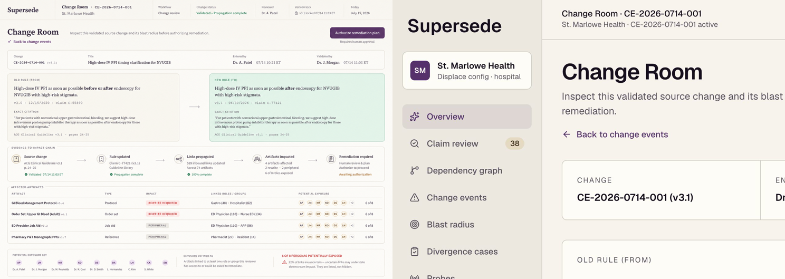
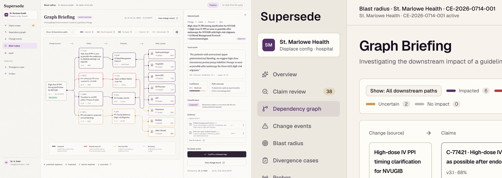
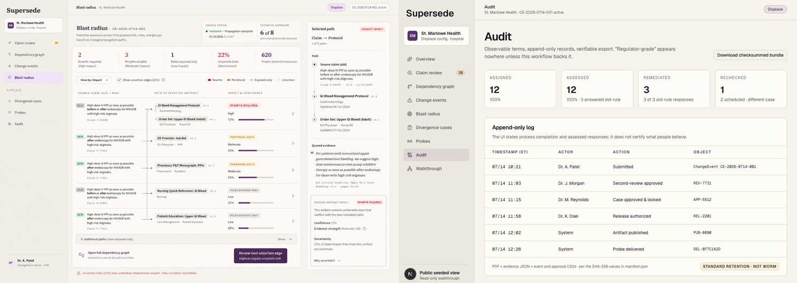

# Design QA

**Reviewed:** July 15, 2026

**Viewports:** 1280 × 720 desktop, plus automated desktop and Pixel 7 coverage

## Change Room

The implementation preserves the approved palette, dense change metadata,
old/new citations, and evidence-to-impact hierarchy. The public walkthrough
shows a read-only boundary and directs governed actions through WorkOS.

## Graph Briefing

The graph preserves dependency paths, confidence, rationale, classification,
and selected evidence. Its bounded surface scrolls horizontally on narrow
screens without widening the page.

## Evidence Ledger

The audit view leads with checksums, approval state, and retention mode. It
claims WORM retention only when S3 Object Lock is configured and succeeds.

## Result

Desktop and mobile checks passed for accessibility, contrast, navigation,
state, and horizontal overflow. The public tenant intentionally replaces
governed controls with clear read-only and authentication states.
