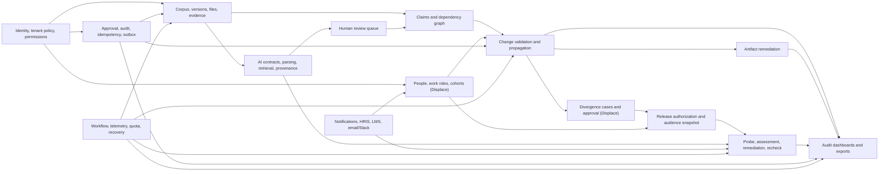

# Supersede — End-to-End Development Plan

**Status:** Recommended implementation sequence  
**Inputs:** [`PRD.md`](./PRD.md), [`TECH_STACK.md`](./TECH_STACK.md),
[`SCHEMA.md`](./SCHEMA.md), and the existing production scaffold  
**Scope:** Complete Propagate product, Displace extension, hackathon vertical slice, and production
readiness—without timeline or effort estimates

## 1. Product understanding and planning decisions

Supersede is a multi-tenant change-propagation and evidence system. It closes the gap between a
changed source of truth and every reviewed downstream dependency. Its product value is the
trustworthy chain, not generic document search or generic training:

1. preserve immutable source and artifact versions;
2. extract claims and evidence-backed dependency candidates;
3. require human review where confidence or evidence is insufficient;
4. require a designated owner to enter a ChangeEvent and a distinct validator to authorize it;
5. walk reviewed graph paths and classify load-bearing, peripheral, and potential-exposure impacts;
6. remediate governed artifacts;
7. in Displace, generate version-locked divergence cases, require expert approval and separate
   release authorization, assess a short cold response, assign realistic correction work, and
   recheck with a different case from the same divergence;
8. report only observable facts—assigned, opened, assessed, remediated, and rechecked—with exact
   versions, actors, approvals, and checksums.

### 1.1 Configurations are security boundaries

- **Propagate** is the commercial v1 artifact-governance configuration. It includes corpus,
  evidence, graph, ChangeEvents, blast radius, artifact remediation, approvals, audit, and exports.
  It has no people/probe data path.
- **Displace** extends Propagate with people/work-role mapping, potential exposure, divergence cases,
  releases, probes, artifact-correction exercises, remediation, and rechecks. It is the hackathon
  hospital demo.
- The `organization.product_configuration` enum is checked by RLS, service policies, APIs,
  workflows, navigation, and report queries. It is not a cosmetic feature flag.

The PRD's configuration summary lists FR-7 inside the Propagate shorthand, but its detailed section
says cases are Displace-gated, and the approved technology-stack configuration matrix explicitly
marks divergence cases/probes as unavailable in Propagate. The detailed requirement and approved
matrix govern implementation: Propagate receives FR-6 blast radius and artifact remediation;
divergence-case generation, approval, release, and learning remain Displace-only. The PRD also skips
the label FR-5; this plan preserves its source numbering and does not invent a missing feature.

FR-12 applies approval governance to both configurations. In Propagate, “release” means the configured
verification/authorization of the exact remediated artifact version before it becomes the current
governed version or is exported downstream; it does not create people assignments. In Displace,
`release_batch` separately authorizes approved case versions and an immutable audience before learner
assignments are created.

### 1.2 Product claims and safety boundaries

- AI proposes structured, evidence-grounded records. Authenticated humans review, validate,
  approve, authorize, and retire governed content.
- A probe is one response under one wording at one time. The system never converts it into a claim
  about a person's belief, knowledge, or competence.
- Cases classified as ambiguous after release are retired, not edited. Their results are excluded
  from metrics without deleting historical evidence.
- The hackathon uses fictional documents and visibly labeled seeded personas. No real clinical,
  employee, or patient data enters the environment.
- Automated source watchers, general LMS authoring, autonomous artifact rewriting, EHR integration,
  and permanent WebSockets are outside scope.

### 1.3 Existing scaffold: retain, then extend

The scaffold already provides:

- Next.js 16 App Router, React 19, strict TypeScript, Server Component defaults, and a Node runtime;
- centralized Tailwind/shadcn semantic tokens, light/dark themes, base primitives, and providers;
- WorkOS AuthKit session boundary, organization-aware identity helpers, CSP, and production fail-closed
  behavior;
- Drizzle, PostgreSQL pooling, transaction-local tenant context, initial RLS, append-only approval and
  audit triggers, and foundation seed/migration tests;
- Zod validation, versioned API conventions, RFC problem details, request IDs, structured redacted
  logging, Sentry/OpenTelemetry hooks, and a development-only OpenAPI route;
- lazy OpenAI Responses API/GPT-5.6, Gemini Embedding 2, R2/S3, and Inngest clients;
  outbox/workflow foundations and a due-work cron;
- Vitest, Testing Library, MSW, axe, Playwright, SQL tests, GitHub Actions, CodeQL, Dependabot, Husky,
  ESLint, and Prettier.

Feature work extends these boundaries. It must not replace them with a second backend, client-only
authorization, a generic agent framework, or a separate graph/vector database.

## 2. Users, roles, and administration model

### 2.1 User groups and usage patterns

| User group                                  | Primary need                                                        | Typical device/context                               |
| ------------------------------------------- | ------------------------------------------------------------------- | ---------------------------------------------------- |
| Pharma medical-affairs/promotional reviewer | Review claims, evidence, source changes, and artifact remediation   | Desktop/laptop; dense evidence and queue work        |
| Hospital CME/quality director               | Configure people policy, oversee releases, completion, and rechecks | Desktop/laptop; dashboards and exceptions            |
| Domain expert/reviewer                      | Validate changes, edges, cases, and citations                       | Desktop/laptop; side-by-side comparison              |
| Artifact owner/steward                      | Understand impact and submit an updated artifact version            | Desktop/tablet; task-focused workflow                |
| Auditor/compliance officer                  | Inspect immutable evidence and generate permitted exports           | Desktop/laptop; tables, timelines, export controls   |
| Learner/professional                        | Complete a short cold probe and realistic correction exercise       | Often mobile; interruption-tolerant 2–10 minute flow |
| Organization administrator                  | Onboard members, assign roles, configure policy and integrations    | Desktop/laptop; infrequent high-risk actions         |
| Platform support/security operator          | Diagnose a tenant issue under an approved short access grant        | Desktop; controlled internal operations surface      |

### 2.2 Tenant roles

The approved initial roles remain authoritative:

| Role                 | Responsibilities                                                                                            | Important exclusions                                                      |
| -------------------- | ----------------------------------------------------------------------------------------------------------- | ------------------------------------------------------------------------- |
| `org_admin`          | Organization setup, membership/role management, privacy, approval, retention, and integration configuration | Does not automatically satisfy domain approvals or see individual results |
| `change_owner`       | Draft and submit ChangeEvents; coordinate impacted artifact work                                            | Cannot validate a ChangeEvent they created                                |
| `change_validator`   | Validate an exact submitted ChangeEvent version                                                             | Cannot validate their own ChangeEvent version                             |
| `edge_reviewer`      | Review claims, evidence spans, dependency edges, and exposure mappings                                      | Cannot bypass evidence/quote requirements                                 |
| `case_approver`      | Approve or retire an exact divergence-case version                                                          | Displace only; cannot release by virtue of approval alone                 |
| `release_authorizer` | Authorize an approved case set and snapshotted audience                                                     | Displace only; policy may require a different requester                   |
| `auditor`            | Read audit history and request policy-permitted report bundles                                              | Individual results require a separate permission and tenant policy        |
| `learner`            | View and complete only their released assignments                                                           | No access to cold-probe answers/rules before submission or other people   |

Permissions, not raw role strings, gate services. Memberships may hold multiple roles, but object-level
separation-of-duties checks still apply.

The initial implementation does not invent additional role codes such as “corpus editor” or “HRIS
operator.” Their capabilities map to the approved roles: `org_admin` manages integrations and tenant
configuration; `change_owner` creates governed corpus/source/artifact/change inputs; `edge_reviewer`
reviews evidence and dependencies. An `artifact_owner` relationship grants only narrow access to view
and submit work for that artifact; it never grants approval, tenant administration, or unrelated
corpus access.

### 2.3 Admin and super-admin decision

- **Organization admin is required.** It is a tenant-scoped role and is implemented early.
- **A tenant super-admin is not required and must not be introduced.** No tenant role should silently
  bypass approval, individual-result, configuration, or RLS rules.
- **Platform operations are required for production, but not as a permanent global super-admin.** A
  platform operator has no default tenant content access. Any support access requires a reason,
  ticket, second-operator approval, tenant-admin consent when organization policy requires it,
  restricted scope, short expiry, and an audit event for every use. Emergency access has a separate
  security-admin path, immediate alerts, and mandatory post-access review.
- Migration owners and emergency database operators remain infrastructure identities, not product
  users. Their access follows an external break-glass runbook and is not exposed in the tenant UI.

### 2.4 Onboarding and account flows

1. A platform provisioning process creates the WorkOS organization and local `organization`, selects
   Propagate or Displace, and creates default settings, roles, permissions, approval policies, and
   retention classes atomically.
2. The first `org_admin` authenticates through hosted WorkOS sign-in and accepts organization context.
3. The admin invites members through WorkOS, then assigns local domain roles. WorkOS proves identity;
   PostgreSQL remains the authorization source.
4. Displace admins import or seed `person` and `work_role` data. A person may exist without a login;
   linking to `membership` happens only when interactive access is needed.
5. Setup validates the selected privacy policy, minimum aggregate cohort size, approval-role coverage,
   storage/provider health, and fictional-data acknowledgement for the demo.
6. Deprovisioning immediately blocks authentication/assignment access, closes active role mappings,
   and preserves historical actor/person references required by audit and retention policy.

## 3. Architecture and dependency map



### 3.1 Implementation rule for every vertical slice

For each module, implement in this order:

1. database migration, RLS, grants, and database-native constraints;
2. Zod contracts, permission policy, repository, and domain service;
3. state-transition, tenant, idempotency, and negative authorization tests;
4. outbox event and Inngest handler where work is asynchronous;
5. first-party Server Component read path and authenticated Server Action mutation;
6. versioned Route Handler only where an external integration, webhook, upload, SSE stream, or stable
   REST contract requires it;
7. accessible UI states and browser coverage;
8. audit/telemetry assertions and failure recovery.

This ensures backend invariants exist before the frontend can initiate a transition. Before changing
Next.js pages, actions, route handlers, proxy behavior, caching, or runtime configuration, read the
relevant local guide in `node_modules/next/dist/docs/` as required by the repository instructions.

## 4. Recommended build sequence

No stage below is a timeline or sprint. A stage is a dependency gate: its exit conditions must hold
before dependent governed behavior begins.

### Stage 0 — Stabilize contracts and schema delivery

**Build**

- Treat the scaffold verification commands as the baseline gate.
- Use Codex 5.6 for repository implementation work, following `AGENTS.md`, the approved stack, and
  the relevant local Next.js 16 documentation before framework changes; human reviewers remain
  accountable for domain, security, database, prompt, and approval decisions.
- Split Drizzle schemas by domain while preserving `src/db/schema/index.ts` as the composition point.
- Add migration linting, destructive-change detection, schema-to-document consistency checks, and a
  production application database role separate from the migration owner.
- Establish shared identifier, pagination, version/ETag, idempotency, problem-details, audit-event,
  and outbox-event contracts.
- Create the declared fictional demo fixtures: three protocols, one CME module, one claims sheet,
  eight visibly seeded personas across two work roles, predetermined response patterns, and distinct
  demo memberships for owner, validator, edge reviewer, case approver, release authorizer, auditor,
  and learner paths. Use deterministic clocks/IDs in tests.
- Add ADRs for any change to database, identity, model/retrieval, approval/versioning, or configuration
  boundaries.

**Validate before Stage 1**

- Existing build, unit, component, browser, migration, RLS, CSP, and dependency checks remain green.
- The application role cannot bypass RLS or mutate append-only records.
- PRD and approved stack remain unchanged unless a separately approved decision updates them.

### Stage 1 — Identity, tenant policy, onboarding, and permissions

**Backend first**

- Implement `organization_settings`, permission mappings, historical membership-role grants, service
  accounts, API credentials, and configuration-aware policy helpers.
- Build WorkOS organization/membership synchronization and deduplicated webhook processing.
- Add onboarding/bootstrap transaction and joiner/mover/leaver services.
- Implement recent-auth/MFA policy hooks even if enterprise MFA setup follows later.
- Add platform-operator/support-grant tables and keep their runtime path disabled until an internal
  operations surface exists.

**Frontend after policy services**

- Organization setup checklist, member/role management, privacy settings, configuration badge, and
  integration-health summary.
- Permission-denied, missing-organization, deprovisioned, and stale-session states.

**Validate before Stage 2**

- Cross-tenant and Propagate/Displace negative tests pass at database and service layers.
- A client-supplied role never changes authorization.
- A deprovisioned user loses access while their historical approvals remain readable.
- No normal role or platform operator has an unbounded tenant bypass.

### Stage 2 — Governance transaction primitives

**Build**

- Implement approval policies and eligible-role mapping, version-reference validation, separation of
  duties, recent-auth/MFA metadata, and append-only approval insertion.
- Extend audit actors to membership/service/system/support operator.
- Implement idempotency records, transactional outbox publication, workflow run/step projections,
  retry/dead-letter visibility, notification records, and usage events.
- Create reusable `authorize → lock/version-check → transition → approval/audit → outbox` transaction
  helpers without hiding domain-specific rules.
- Build the review-task/session/action framework and reviewer-effort metrics.

**Frontend**

- Shared approval panel, version badge, stale-write conflict dialog, review inbox, audit timeline,
  workflow progress banner, and retry/error affordance.

**Validate before Stage 3**

- Same idempotency key/same payload replays safely; same key/different payload returns `409`.
- State transition, approval record, audit event, and outbox event commit or roll back together.
- Update/delete attempts on append-only records fail under the application role.

### Stage 3 — Corpus, file storage, sources, and artifacts

**Backend first**

- Add corpora, upload sessions, storage objects, immutable document versions, sources/source versions,
  artifacts/artifact versions, owners, and evidence spans.
- Implement signed direct upload, quarantine, MIME/signature/size/quota validation, SHA-256 hashing,
  curated-demo scan bypass labeling, promotion to private working storage, and safe cleanup.
- Add paste-text ingestion for the live hackathon extraction.
- Enforce immutable approved versions and explicit supersession/retirement.

**Frontend**

- Corpus list/detail, source/artifact inventory, upload/paste wizard, duplicate warning, processing
  status, version history, owner assignment, and exact evidence viewer shell.

**Validate before Stage 4**

- Tenant A cannot request or use Tenant B's signed object URL.
- A mismatched extension/MIME/signature, oversize file, duplicate idempotency key, or unsupported
  image-only PDF produces a clear recoverable state.
- Approved versions cannot be edited; successors preserve the original hash and history.

### Stage 4 — Parsing, chunking, hybrid retrieval, and AI provenance

**Backend first**

- Implement format adapters for text/Markdown/HTML, text PDFs (`pdfjs-dist`), DOCX (`mammoth`), and
  spreadsheets (SheetJS/`xlsx`) in the approved order; visibly flag scanned/image-only PDFs until an
  OCR adapter is approved.
- Preserve layout coordinates and normalization mappings, create chunks, lexical vectors, 768-dimension
  `gemini-embedding-2` embeddings, and side-by-side embedding-version support.
- Implement tenant/version/status-filtered lexical + vector retrieval with reciprocal-rank fusion.
- Create versioned prompt contracts, model runs, input/retrieval provenance, token/cost budgets,
  provider timeouts, validation retry-once behavior, and partial/quota-paused states.
- Build prompt-injection-resistant document delimiters and exact/fuzzy quote verification.

**Frontend**

- Processing manifest, page/chunk warnings, unsupported-page callouts, provider/run status, and
  evidence jump-to-location behavior.

**Validate before Stage 5**

- Search never returns a different tenant, superseded disallowed version, or inaccessible object.
- Numerical thresholds/citations are recoverable lexically; embedding-only similarity is not treated
  as evidence.
- Every model result links prompt/schema/model/input/retrieval versions and exposes no hidden reasoning.
- AI eval fixtures cover negation, conflicting citations, tables, no-answer text, and prompt injection.

### Stage 5 — Claim extraction and human review

**Backend first**

- Implement `claim_extraction_v1` and `load_bearing_v1` structured schemas through GPT-5.6 on the
  OpenAI Responses API.
- Persist suggested claim/edge versions only after quote validation; failed or low-confidence results
  create review tasks.
- Implement accept, edit-as-new-version, reject, defer, and human-verify actions.
- Capture review sessions and active duration needed for the PRD reviewer-effort target.

**Frontend**

- Extraction run screen with live/polled stages, claim cards, confidence label plus rationale, quoted
  evidence, page/section location, bulk keyboard review, and a side-by-side evidence drawer.
- Never use color as the sole confidence indicator.

**Validate before Stage 6**

- The live fictional protocol yields quote-locatable claims under the labeled eval contract.
- Invalid quotes cannot become accepted evidence without an explicit human-verification record.
- Review throughput metrics can calculate minutes per 50 reviewed claims without logging content.

### Stage 6 — Reviewed graph and Displace people exposure

**Backend first**

- Add claim identities/versions, graph nodes, dependency edge identities/versions, current-version
  selection, bidirectional indexes, and bounded cycle-safe recursive traversal.
- Implement accepted-edge-only traversal by default and separate unreviewed candidates.
- Add people, work roles, person-role mappings, cohorts, and role-artifact exposure review for Displace.
- Enforce product configuration in migrations, policies, services, events, and queries.

**Frontend**

- Relevant-subgraph viewer capped at 200 initial nodes; server-side filtering, clustering by artifact,
  keyboard/list alternative, zoom controls, typed edge legend, confidence/rationale, and evidence drawer.
- People import/mapping page labels all role-derived people as “potentially exposed.”

**Validate before Stage 7**

- Recursive SQL returns complete paths, terminates on cycles, respects depth, and is stable across
  pagination/rendering.
- Unreviewed edges cannot silently drive the authoritative blast radius.
- Propagate users cannot query or invoke people/exposure paths, including background events.
- The seeded six-of-eight potential-exposure result is reproducible from role mappings.

### Stage 7 — ChangeEvent validation and blast radius

**Backend first**

- Implement ChangeEvent identities/versions, `change_diff_v1`, draft/submission/stale-version rules,
  verified old/new evidence citations, creator-validator separation, and validation transaction.
- On validation, emit an outbox event and run bounded graph propagation in Inngest.
- Persist propagation cutoff, complete paths, load-bearing/peripheral/unreviewed impacts, and Displace
  potential exposure.
- Build safe retry and new-run semantics without duplicating impacts.

**Frontend**

- Multi-step ChangeEvent wizard: select same-source old/new approved versions, inspect both documents,
  enter/confirm old rule, new rule, affected population, exclusions, and ambiguity, then submit.
- Validator queue and side-by-side validation screen make the creator identity and locked version clear.
- Blast-radius page shows summary, graph/list views, evidence, confidence, rationale, reviewed versus
  candidate impacts, and processing/partial/failure states.

**Validate before Stage 8**

- Creator validation and stale-version validation fail in the database/service transaction.
- Validation, approval, audit, and outbox are atomic.
- Hackathon propagation completes below the local target and reproduces protocol P-114 as load-bearing,
  the CME module as peripheral, and six of eight personas as potential exposure.
- No-impact and partial-provider-failure states are honest and actionable.

### Stage 8 — Artifact remediation and complete Propagate loop

**Backend first**

- Create one artifact-remediation task per impacted artifact with required action and current owner.
- Accept a new artifact version or retirement, require it to supersede the impacted version, and
  support reviewer verification/return-for-revision and configured release authorization before the
  version becomes current.
- Recompute artifact-completion metrics from immutable version/task facts.

**Frontend**

- Impact-to-task conversion, owner work queue, old/new artifact comparison, upload/edit successor,
  verification panel, due/overdue status, and audit history.

**Validate before Stage 9**

- A task cannot resolve against an unrelated or older artifact version.
- Owner, reviewer, and validator permissions remain distinct where policy requires.
- Propagate can complete ingestion → change → blast radius → artifact remediation → audit without any
  Displace table or route.

### Stage 9 — Divergence, case approval, and release authorization

**Backend first**

- Add divergence grouping, `divergence_case_v1`, exact old/new citations, immutable case versions,
  approval preconditions, append-only retirement, and historical-metric exclusion.
- Add release batches, approved case sets, role/cohort/person audience resolution, immutable
  `release_target_person` snapshot rows plus audience hashes, separate release authorization, and
  idempotent assignment creation from that snapshot.
- Create/review correction-exercise versions grounded in the new source and include exact approved
  exercise versions in the release snapshot; no exercise generated after release may reach a learner
  without a successor approval/release.
- Require enough approved distinct cases for initial and 30/90-day use before release, or show a
  blocking coverage state.

**Frontend**

- Case generation run, case comparison/editor, both-source citation viewer, ambiguity checklist,
  approval/version-lock action, retirement flow, case and exercise coverage indicators, correction-
  exercise review, audience preview, and release authorization screen.

**Validate before Stage 10**

- No draft, uncited, unapproved, or retired case can enter a release.
- No unapproved or non-released correction exercise can be selected for remediation.
- Editing an approved case creates a new draft version and does not alter existing assignments.
- Requester/authorizer rules and audience snapshots are reproducible even if HRIS mappings change
  after authorization.
- Post-hoc ambiguity excludes metrics but preserves all original evidence.

### Stage 10 — Learner probe, assessment, remediation, and recheck

**Backend first**

- Implement learner-scoped assignment retrieval that does not disclose the changed rule before
  submission.
- Record assigned/opened/submitted/completed independently and accept exactly one idempotent response.
- Implement deterministic grading where possible and `probe_grade_v1` for free text. Route `other` or
  low-confidence results to human review.
- Create one exercise assignment from a current old-rule assessment using only an approved exercise
  version in the triggering release; implement `artifact_feedback_v1`, attempts, cited feedback, and
  human review fallback.
- On pass, schedule 30/90-day rows. Daily dispatch selects an approved, unretired, different case from
  the same divergence that has not been used for that person's initial or other recheck, then creates
  a probe assignment.
- Handle person deprovisioning, no alternate case, cancelled releases, and provider quota failure.

**Frontend**

- Mobile-first learner home, cold scenario, accessible response control, confirmation, correction
  exercise, cited feedback, completion receipt, and recheck-pending status.
- Save safe draft state for the exercise, but do not allow a probe answer to be changed after final
  submission.
- Reviewer ambiguity queue exposes the response only to authorized roles.

**Validate before Stage 11**

- A learner cannot read another assignment or the answer/rationale before submitting.
- “Other” is never coerced to old/new; human reassessment creates a new immutable revision.
- Same-case identity reuse—including a newer version of the same scenario—or a different-divergence
  recheck is rejected by database constraints.
- The scripted R.N. Adams path produces assessed old-rule response → correction → pass → two scheduled
  rechecks using eligible distinct cases.

### Stage 11 — Audit dashboards, exports, retention, and legal hold

**Backend first**

- Build approved query services for artifact and, in Displace, person-level observable timelines.
- Calculate aggregates from current valid assessments while honoring case-retirement exclusions,
  cohort minimums, individual-result policy, and query cutoff.
- Define metrics in code and report copy: assigned = assignment created; assessed = valid submitted
  response with a current assessment on an approved non-excluded case; remediated = required exercise
  passed; recheck-clean = a due recheck completed on a distinct eligible case with current label
  `new`. Open/delivered events never substitute for assessed or remediated.
- Implement report request, repeatable-read snapshot, versioned HTML and Playwright/Chromium PDF
  render, CSV/JSON evidence, `jszip` packaging, manifest, SHA-256 bundle, optional HMAC, R2/S3 Object
  Lock storage, and completion audit.
- Add versioned retention policies, legal holds, disposition dry runs, and authorized execution.
- Add prohibited-language tests for templates and UI summaries.

**Frontend**

- ChangeEvent audit dashboard with assigned/assessed/remediated/rechecked funnels, artifact completion,
  recheck pending/clean states, role/cohort aggregates, approval timeline, and version provenance.
- Export configuration warns when individual data is disallowed, shows cutoff/retention, progress,
  checksum verification, and failure recovery.

**Validate before Stage 12**

- Dashboard numbers reconcile to SQL fixtures and remain stable for a fixed cutoff.
- Retired ambiguous cases disappear from metrics but remain visible in the audit trail.
- Aggregate suppression and individual permissions cannot be bypassed through API/export.
- Bundle members match the manifest; tampering fails checksum verification.
- Legal hold blocks disposition and object deletion.

### Stage 12 — Delivery and enterprise integration adapters

Build adapters only after the in-app core loop is complete.

**Order**

1. in-app notifications and simulated seeded-persona runner;
2. Postmark delivery with signed/deduplicated webhooks;
3. Slack adapter;
4. HRIS CSV import with preview, mapping, partial-row errors, and deprovision behavior;
5. xAPI export, then SCORM only if required.

**Validate before Stage 13**

- Provider delivery/open/completion facts remain separate.
- Webhook signature, replay, unknown event, bounce, and retry tests pass.
- Partial imports are reversible/re-runnable and never cross organizations.
- Export adapters use immutable domain IDs/versions and do not become a second source of truth.

### Stage 13 — Full integration, operations, and release validation

**Build and harden**

- Role-aware dashboards, global review inbox, workflow/dead-letter operations, quotas, usage/cost views,
  health checks, alerting, trace correlation, and restore/runbook documentation.
- Optimize measured queries, connection use, graph traversal, HNSW settings, report generation, and
  bundle storage; do not add infrastructure pre-emptively.
- Validate the approved initial service objectives: non-AI interactive P95 below 500 ms, upload
  acknowledgement below 2 seconds, hackathon propagation below 60 seconds, at most 200 initially
  rendered graph nodes, and visible queued/running/partial/failed/completed state for every workflow.
- Add synthetic preview data, deployment environment isolation, explicit migration promotion, release
  SHA recording, rollback/forward-fix procedure, and backup/restore drill.
- Complete threat model for cross-tenant access, IDOR, prompt injection, stale approval, malicious
  upload, webhook replay, export leakage, support access, and service-role abuse.
- Verify production-only HSTS after TLS/domain readiness, nonce CSP, secure cookie/origin behavior,
  upload limits, Vercel firewall/rate rules, and webhook allow-list/signature controls without
  weakening local development.
- Rehearse the exact five-minute demo with live extraction and a clearly labeled fallback fixture.

**Release gates**

- Complete browser-to-database critical paths and negative role/configuration paths pass.
- Labeled AI evaluation meets agreed extraction, citation, divergence, ambiguity, and grading thresholds.
- Reviewer-effort instrumentation supports the under-15-minutes-per-50-claims target measurement.
- Accessibility audit reaches WCAG 2.2 AA for critical reviewer and learner paths.
- Dependency, secret, CodeQL, migration-policy, RLS, and restore checks pass.
- No report/template uses prohibited inferential vocabulary.
- Real-customer production remains blocked until privacy/employment review, contracts, residency,
  BAA assessment where applicable, penetration testing, incident response, and access-review gates
  are complete.

## 5. Major module implementation contracts

Each contract below supplies the nine required planning dimensions: purpose, users, capabilities,
frontend, backend, schema dependencies, module dependencies, prerequisites, and exit validation.

### 5.1 Identity and tenant administration

| Dimension            | Project-specific plan                                                                                                                                                                                                              |
| -------------------- | ---------------------------------------------------------------------------------------------------------------------------------------------------------------------------------------------------------------------------------- |
| Purpose              | Establish authenticated organization context and enforce configuration, role, permission, privacy, and support-access boundaries.                                                                                                  |
| Users/roles          | `org_admin`, all authenticated members, service accounts; platform operators through a separate internal path.                                                                                                                     |
| Main capabilities    | WorkOS sign-in/sync, organization bootstrap, membership lifecycle, role assignment/revocation, service credentials, privacy/configuration settings, controlled support grants.                                                     |
| Frontend             | Hosted sign-in redirect/callback, setup checklist, member and role tables, settings forms, service-account credential-once flow, deprovision confirmation, configuration-aware navigation.                                         |
| Backend              | WorkOS verification/webhooks, actor resolution, tenant transactions, permission policy, recent-auth/MFA hooks, configuration enforcement, credential hashing/rotation, support-grant validation.                                   |
| `SCHEMA.md` entities | `organization`, `organization_settings`, `membership`, `role`, `permission`, `role_permission`, `membership_role`, `service_account`, `service_account_permission`, `api_credential`, `platform_operator`, `support_access_grant`. |
| Module dependencies  | Scaffold environment/auth/proxy/database; emits audit events and notifications.                                                                                                                                                    |
| Complete first       | Stage 0 contracts, app database role, RLS test harness, WorkOS environments.                                                                                                                                                       |
| Exit validation      | Cross-tenant/role/config negative tests, deprovision behavior, credential rotation, no client-controlled authorization, no permanent support bypass.                                                                               |

### 5.2 Governance, approval, audit, and workflow foundation

| Dimension            | Project-specific plan                                                                                                                                                                                                |
| -------------------- | -------------------------------------------------------------------------------------------------------------------------------------------------------------------------------------------------------------------- |
| Purpose              | Make every governed transition atomic, version-specific, explainable, idempotent, and recoverable.                                                                                                                   |
| Users/roles          | Every acting role; `org_admin` configures policy; `auditor` inspects; system/service actors emit non-approval events.                                                                                                |
| Main capabilities    | Approval policy, separation of duties, append-only records, review queues, idempotency, outbox, workflow projections, retry/dead-letter state, usage ledger.                                                         |
| Frontend             | Review inbox, approval panel, version/stale warnings, audit timeline, progress/partial/failure banners, authorized retry.                                                                                            |
| Backend              | Transaction helpers, DB triggers/grants, policy evaluator, outbox publisher, Inngest projection, event payload allow-list, correlation IDs.                                                                          |
| `SCHEMA.md` entities | `approval_policy`, `approval_policy_role`, `approval_record`, `audit_event`, `review_task`, `review_session`, `review_action`, `workflow_run`, `workflow_step`, `outbox_event`, `idempotency_record`, `usage_event`. |
| Module dependencies  | Identity and tenant context only; all later modules depend on it.                                                                                                                                                    |
| Complete first       | Active roles/permissions, database clock/version conventions.                                                                                                                                                        |
| Exit validation      | Atomic rollback tests, append-only mutation denial, policy role/SoD tests, replay behavior, redaction tests, failed-work visibility.                                                                                 |

### 5.3 Corpus, files, sources, and artifacts

| Dimension            | Project-specific plan                                                                                                                                                                                |
| -------------------- | ---------------------------------------------------------------------------------------------------------------------------------------------------------------------------------------------------- |
| Purpose              | Preserve original governed content, immutable versions, ownership, parseability, and exact citation locations.                                                                                       |
| Users/roles          | `change_owner`, `edge_reviewer`, `org_admin` for setup, artifact owners with narrow object access, and auditors.                                                                                     |
| Main capabilities    | Corpus organization, paste/upload, quarantine/scan/hash, source/artifact creation, version/supersession, owners, evidence spans, signed access.                                                      |
| Frontend             | Corpus inventory, upload/paste wizard, processing state, source/artifact detail, version history, owner controls, evidence viewer.                                                                   |
| Backend              | Upload sessions, R2/S3 adapters, validation/quota, hash/scan, immutable version service, signed URLs, storage lifecycle, parsing event emission.                                                     |
| `SCHEMA.md` entities | `corpus`, `upload_session`, `storage_object`, `document_version`, `source`, `source_version`, `artifact`, `artifact_version`, `artifact_owner`, `corpus_source`, `corpus_artifact`, `evidence_span`. |
| Module dependencies  | Identity, governance, storage configuration, workflow foundation.                                                                                                                                    |
| Complete first       | Tenant quotas, retention class defaults, object-path policy, upload threat model.                                                                                                                    |
| Exit validation      | File-validation matrix, tenant URL isolation, hash reproducibility, immutable approved versions, cleanup/retention behavior, unsupported OCR state.                                                  |

### 5.4 Parsing, retrieval, and AI provenance

| Dimension            | Project-specific plan                                                                                                                                                           |
| -------------------- | ------------------------------------------------------------------------------------------------------------------------------------------------------------------------------- |
| Purpose              | Convert immutable documents into location-preserving chunks and produce reproducible, schema-valid AI results.                                                                  |
| Users/roles          | Reviewers observe results; workflows execute; engineers/domain owners approve prompt/model changes.                                                                             |
| Main capabilities    | Format parsing, chunking, FTS/vector embedding, hybrid retrieval, prompt/schema registry, model budgets, provenance, quote verification.                                        |
| Frontend             | Processing manifest, parser warnings, unsupported pages, retrieval/evidence inspection, provider failure and quota states.                                                      |
| Backend              | Parser adapters, Gemini embedding, pgvector/GIN indexes, filtered RRF retrieval, OpenAI Responses calls, structured validation, cache/idempotency, prompt-injection guardrails. |
| `SCHEMA.md` entities | `document_chunk`, `ai_prompt_version`, `extraction_run`, `ai_model_run`, `ai_run_input`, `ai_run_retrieval_chunk`, `evidence_span`, `usage_event`.                              |
| Module dependencies  | Corpus versions, workflow foundation, provider clients.                                                                                                                         |
| Complete first       | Immutable documents, data-class policy, AI fixtures and version conventions.                                                                                                    |
| Exit validation      | Tenant/version retrieval isolation, dimension/index checks, provenance completeness, cost limits, adversarial evals, no hidden reasoning storage.                               |

### 5.5 Claims, review, and dependency graph

| Dimension            | Project-specific plan                                                                                                                                            |
| -------------------- | ---------------------------------------------------------------------------------------------------------------------------------------------------------------- |
| Purpose              | Create a human-reviewable, evidence-backed graph that can support explainable propagation.                                                                       |
| Users/roles          | `edge_reviewer`, artifact/source stewards, `change_owner`, auditor.                                                                                              |
| Main capabilities    | Claim extraction, load-bearing scoring, suggestion queue, accept/edit/reject, typed/versioned edges, bounded traversal, graph/list inspection.                   |
| Frontend             | Reviewer queue, claim/edge cards, evidence drawer, confidence/rationale, bulk keyboard actions, relevant-subgraph visualization and accessible list alternative. |
| Backend              | Extraction contracts, quote checks, claim/edge version services, graph-node integrity, current accepted-edge query, recursive CTE, cycle/depth protection.       |
| `SCHEMA.md` entities | `claim`, `claim_version`, `graph_node`, `dependency_edge`, `dependency_edge_version`, `review_task`, `review_session`, `review_action`, `extraction_run`.        |
| Module dependencies  | Corpus, AI/retrieval, governance.                                                                                                                                |
| Complete first       | Accepted evidence spans, prompt/eval gate, reviewer permission.                                                                                                  |
| Exit validation      | Labeled precision, quote validity, review-effort measurement, cycle tests, path reproducibility, 200-node UI cap and keyboard accessibility.                     |

### 5.6 People, work roles, and potential exposure

| Dimension            | Project-specific plan                                                                                                                                                            |
| -------------------- | -------------------------------------------------------------------------------------------------------------------------------------------------------------------------------- |
| Purpose              | Map artifacts to work roles and people for potential exposure without claiming knowledge.                                                                                        |
| Users/roles          | Displace `org_admin` performs HRIS operations; `edge_reviewer` reviews mappings; quality/CME directors hold applicable approved roles; auditors receive policy-filtered results. |
| Main capabilities    | Person import/linking, work roles, role membership, cohorts, role-artifact exposure review, audience counts, deprovisioning.                                                     |
| Frontend             | Import preview/errors, people/work-role directory, exposure mapping review, cohort builder, seeded-persona labels, privacy policy callouts.                                      |
| Backend              | HRIS normalization, effective-dated mappings, person-membership linking, configuration guard, cohort minimum policy, exposure query.                                             |
| `SCHEMA.md` entities | `person`, `work_role`, `person_work_role`, `cohort`, `cohort_member`, `role_artifact_exposure`, `integration_connection`, `integration_job`, `integration_job_item`.             |
| Module dependencies  | Identity, corpus/artifacts, review/governance; Displace configuration.                                                                                                           |
| Complete first       | Individual-result policy, deprovision rules, fictional seed dataset.                                                                                                             |
| Exit validation      | Propagate denial, six-of-eight seeded exposure, aggregate suppression, effective-date behavior, no automatic login creation for imported people.                                 |

### 5.7 ChangeEvents and propagation

| Dimension            | Project-specific plan                                                                                                                                                                            |
| -------------------- | ------------------------------------------------------------------------------------------------------------------------------------------------------------------------------------------------ |
| Purpose              | Turn a manually entered, dual-controlled source change into a reproducible triaged blast radius.                                                                                                 |
| Users/roles          | `change_owner`, distinct `change_validator`, edge reviewers, artifact owners, auditors.                                                                                                          |
| Main capabilities    | Draft/version, structured diff, submission, validation, graph traversal, impact/path persistence, confidence/rationale, retry.                                                                   |
| Frontend             | Old/new source wizard, side-by-side evidence, validator queue, processing progress, impact summary/table/graph, no-impact/partial states.                                                        |
| Backend              | Version/ETag checks, `change_diff_v1`, SoD transaction, outbox/Inngest propagation, bounded accepted-edge traversal, impact classification and path storage.                                     |
| `SCHEMA.md` entities | `change_event`, `change_event_version`, `change_event_version_citation`, `propagation_run`, `change_impact`, `change_impact_path`, `change_impact_path_step`, `approval_record`, `workflow_run`. |
| Module dependencies  | Reviewed graph, corpus/source versions, governance; people exposure optionally in Displace.                                                                                                      |
| Complete first       | Accepted graph and old/new source versions, validator coverage, propagation eval fixture.                                                                                                        |
| Exit validation      | Creator-validator denial, atomic validation, duplicate-run idempotency, complete path evidence, load-bearing/peripheral results, under-one-day production target instrumentation.                |

### 5.8 Artifact remediation

| Dimension            | Project-specific plan                                                                                                                            |
| -------------------- | ------------------------------------------------------------------------------------------------------------------------------------------------ |
| Purpose              | Close artifact impacts with a governed successor/retirement and verifiable owner/reviewer action.                                                |
| Users/roles          | Artifact owners/stewards, change owners, configured reviewers, auditors.                                                                         |
| Main capabilities    | Task creation, action classification, owner assignment, successor upload/edit, comparison, verification/release authorization, overdue tracking. |
| Frontend             | Owner task queue, impact/evidence context, old/new artifact diff, successor form, reviewer decision and timeline.                                |
| Backend              | Idempotent task generation, artifact-version constraint, verification policy, audit/outbox transaction, metrics query.                           |
| `SCHEMA.md` entities | `artifact_remediation`, `artifact`, `artifact_version`, `artifact_owner`, `change_impact`, `approval_record`, `audit_event`.                     |
| Module dependencies  | Change impacts, corpus/artifacts, governance.                                                                                                    |
| Complete first       | Blast radius, current owners, version successor rules.                                                                                           |
| Exit validation      | Unrelated version rejection, owner/reviewer authorization, completion metric reconciliation, complete Propagate path.                            |

### 5.9 Divergence cases and release

| Dimension            | Project-specific plan                                                                                                                                                                                   |
| -------------------- | ------------------------------------------------------------------------------------------------------------------------------------------------------------------------------------------------------- |
| Purpose              | Produce distinct, cited old/new scenarios and release only expert-approved immutable versions to an authorized audience.                                                                                |
| Users/roles          | Displace domain experts, `case_approver`, release requester, `release_authorizer`, auditor.                                                                                                             |
| Main capabilities    | Divergence grouping, case generation/edit-version, two-sided citations, approval/lock, retirement, coverage check, audience snapshot, release.                                                          |
| Frontend             | Case workbench, old/new citation panels, ambiguity checklist, approval/retirement, case coverage, audience preview, authorization confirmation.                                                         |
| Backend              | `divergence_case_v1`, citation/quote checks, immutable version approval, retirement exclusion, audience resolver/hash, release transaction and assignment outbox.                                       |
| `SCHEMA.md` entities | `divergence`, `divergence_case`, `divergence_case_version`, `case_version_citation`, `case_retirement`, `release_batch`, `release_case`, `release_exercise`, `release_target`, `release_target_person`. |
| Module dependencies  | Validated change/impacts, AI/retrieval, people/cohorts, governance.                                                                                                                                     |
| Complete first       | Old/new evidence, case approver and release roles, enough distinct cases for rechecks.                                                                                                                  |
| Exit validation      | Draft/uncited/retired release denial, edit creates successor, separate release authorization, post-hoc ambiguity behavior, reproducible audience.                                                       |

### 5.10 Learning, assessment, remediation, and recheck

| Dimension            | Project-specific plan                                                                                                                                                                    |
| -------------------- | ---------------------------------------------------------------------------------------------------------------------------------------------------------------------------------------- |
| Purpose              | Deliver a short dignified assessment, correct only an observed old-rule response, and measure later responses with different cases.                                                      |
| Users/roles          | Learners/professionals; authorized ambiguity reviewers; CME/quality director sees policy-safe aggregates.                                                                                |
| Main capabilities    | Cold probe, delivery evidence, immutable response, old/new/other assessment, realistic correction attempt, cited feedback, 30/90-day dispatch.                                           |
| Frontend             | Mobile learner home, focused scenario/answer, submission receipt, correction editor, feedback with new citation, completion/recheck status; reviewer ambiguity queue.                    |
| Backend              | Learner ownership scope, idempotent submit, deterministic/AI/human assessment revisions, assignment state machine, exercise grading, due-row dispatch, distinct-case constraint.         |
| `SCHEMA.md` entities | `probe_assignment`, `probe_delivery_event`, `probe_response`, `probe_assessment`, `exercise`, `exercise_version`, `remediation_assignment`, `remediation_attempt`, `recheck_assignment`. |
| Module dependencies  | Released cases/audience, people, AI, notifications, workflow/governance.                                                                                                                 |
| Complete first       | Approved distinct cases, privacy policy, delivery adapter (in-app is sufficient).                                                                                                        |
| Exit validation      | Learner isolation, no answer leakage, other/ambiguity handling, cited remediation feedback, exactly 30/90 schedules, different-case same-divergence enforcement.                         |

### 5.11 Reporting, retention, and audit export

| Dimension            | Project-specific plan                                                                                                                                                                     |
| -------------------- | ----------------------------------------------------------------------------------------------------------------------------------------------------------------------------------------- |
| Purpose              | Show and export verifiable observable process completion while enforcing privacy, version, retention, and vocabulary rules.                                                               |
| Users/roles          | `auditor`, quality/compliance directors, artifact governance leaders; privileged export/retention administrators.                                                                         |
| Main capabilities    | Change dashboard, artifact/person timelines, aggregates, ambiguity exclusion, cohort suppression, consistent snapshot, PDF/CSV/JSON bundle, checksum/Object Lock, legal hold/disposition. |
| Frontend             | Audit dashboard, filterable tables/charts, approval/version timeline, export wizard/progress/verification, retention/hold admin pages.                                                    |
| Backend              | Policy-filtered SQL projections, repeatable-read cutoff, report rendering, manifest/hash, S3 Object Lock, signed retrieval, retention and hold workflows, banned-language test.           |
| `SCHEMA.md` entities | `approval_record`, `audit_event`, `report_bundle`, `report_bundle_item`, `retention_policy`, `legal_hold`, `data_disposition_run`, plus all reported domain entities.                     |
| Module dependencies  | Governance plus completed Propagate/Displace event chains, storage, workflow.                                                                                                             |
| Complete first       | Observable event semantics, individual-result policy, report template/version convention.                                                                                                 |
| Exit validation      | SQL/dashboard reconciliation, fixed-cutoff reproducibility, privacy bypass tests, ambiguity exclusion, bundle tamper test, legal-hold enforcement, vocabulary allow-list.                 |

### 5.12 Integrations and notifications

| Dimension            | Project-specific plan                                                                                                                                                                 |
| -------------------- | ------------------------------------------------------------------------------------------------------------------------------------------------------------------------------------- |
| Purpose              | Connect identity, delivery, HRIS, and LMS systems without moving domain truth out of Supersede.                                                                                       |
| Users/roles          | `org_admin` configures and operates integrations; learners/recipients and auditors consume policy-scoped outcomes.                                                                    |
| Main capabilities    | Connection setup/health, signed webhooks, in-app/email/Slack delivery, HRIS CSV import, xAPI/SCORM export, partial error recovery.                                                    |
| Frontend             | Connection cards, setup/verify, import mapping/preview/result, delivery status, retry, export download, clear simulation labels.                                                      |
| Backend              | Adapter interfaces, secret references, signature/replay checks, provider event dedupe, import job/items, notification delivery, domain-ID/version mapping.                            |
| `SCHEMA.md` entities | `integration_connection`, `integration_event`, `integration_job`, `integration_job_item`, `notification`, `notification_preference`, `notification_delivery`, `probe_delivery_event`. |
| Module dependencies  | Identity; people for HRIS; learning for delivery; reporting for LMS export.                                                                                                           |
| Complete first       | In-app core loop and stable domain events/contracts.                                                                                                                                  |
| Exit validation      | Signature/replay/bounce/retry tests, partial import handling, simulation labeling, no provider open interpreted as assessment.                                                        |

### 5.13 Operations, observability, and reliability

| Dimension            | Project-specific plan                                                                                                                                          |
| -------------------- | -------------------------------------------------------------------------------------------------------------------------------------------------------------- |
| Purpose              | Keep asynchronous governed work visible, bounded, recoverable, measurable, and affordable.                                                                     |
| Users/roles          | Authorized organization operators, platform engineering/support, auditors for domain outcomes.                                                                 |
| Main capabilities    | Workflow progress, retries/dead letters, quota/cost, health, correlation, alerts, backup/restore, release traceability.                                        |
| Frontend             | Organization operations page with safe summaries, failed/paused runs, authorized retry, provider configuration health; internal support surface behind grants. |
| Backend              | Inngest steps/concurrency, outbox lag, pino/Sentry/OTel redaction, health checks, usage ledger, tenant throttles, PITR/restore runbook.                        |
| `SCHEMA.md` entities | `workflow_run`, `workflow_step`, `outbox_event`, `usage_event`, `support_access_grant`, `audit_event`.                                                         |
| Module dependencies  | Identity/governance and every asynchronous module.                                                                                                             |
| Complete first       | Correlation/redaction conventions and provider environment separation.                                                                                         |
| Exit validation      | Provider outage/partial/retry drills, no sensitive telemetry, quota pause visibility, stale-work detection, backup restore, support access audit.              |

## 6. UI/UX plan

### 6.1 Responsive strategy: adaptive desktop-first

The product should be **desktop-first for governance work** because its primary buyer/reviewer tasks
involve side-by-side documents, quoted evidence, dense queues, graph paths, version comparison, and
audit tables. Compressing those tasks into a mobile-first information hierarchy would increase
cognitive load and hide context.

The **learner experience is a separate mobile-first surface** because probes are short, frequently
opened from a notification, and must be completable in 2–4 minutes; correction exercises should fit
within the complete 10-minute delta-focused experience. This is not a contradiction: the shared
system is responsive, while each task uses the layout best suited to its user and information density.

- Desktop: persistent sidebar, contextual secondary navigation, resizable evidence drawer, split
  views, wide tables, and relevant-subgraph canvas.
- Tablet: collapsible sidebar, one primary panel plus drawer/sheet, tables that prioritize key columns.
- Mobile governance: task list/cards, filters in a sheet, evidence as a full-screen route, graph as an
  accessible impact/path list with optional focused canvas.
- Mobile learner: single-column, large targets, minimal chrome, no hover dependency, resilient to
  interruption, explicit progress and confirmation.

### 6.2 Information architecture and navigation

#### Public area

- `/` — concise product/configuration explanation and sign-in entry.
- `/sign-in` and `/auth/callback` — WorkOS hosted authentication flow.
- Production additions: privacy, security, accessibility, and support/contact pages. They contain no
  tenant content.

#### Authenticated application

```text
/app
  /inbox                         Review, approval, remediation, and workflow tasks
  /corpus
    /new                         Upload/paste flow
    /[corpusId]                  Sources, artifacts, extraction runs, review status
  /sources/[sourceId]            Versions, evidence, linked changes
  /artifacts/[artifactId]        Versions, claims, owners, remediation history
  /reviews                       Claim/edge/quote/ambiguity queues
  /graph                         Search/focused graph explorer
  /changes
    /new                         ChangeEvent wizard
    /[changeId]
      /overview                  Version and validation state
      /impacts                   Blast radius, paths, artifact tasks
      /cases                     Displace only
      /release                   Displace only
      /audit                     Observable dashboard and exports
  /learning                      Learner assignments and completion receipts
    /probe/[assignmentId]
    /remediation/[assignmentId]
  /reports                       Export history and verification
  /people                        Displace admin/reviewer only
  /admin
    /organization
    /members
    /roles
    /policies
    /retention
    /integrations
  /operations                    Authorized workflow/provider health
```

Navigation is permission- and configuration-aware for clarity, but every destination independently
authorizes on the server. Learners receive a reduced application shell containing only their tasks,
completion history, profile/accessibility preferences, and support.

### 6.3 Role-based dashboards

- **Org admin:** setup completeness, membership/deprovision exceptions, approval-role coverage,
  provider/integration health, privacy/retention warnings, and configuration label.
- **Change owner:** draft/submitted changes, reports processing, impacted artifact completion, and
  blockers requiring another role.
- **Validator:** exact versions awaiting validation, creator identity, source comparison, unresolved
  ambiguity, and stale-version alerts.
- **Edge reviewer:** prioritized evidence queue, quote failures, low-confidence candidates, review
  throughput, and focused graph context.
- **Case approver:** generated drafts, citation completeness, ambiguity checklist, case coverage for
  rechecks, and retirement tasks.
- **Release authorizer:** approved content set, audience snapshot, policy/privacy warnings, and
  authorization history.
- **Auditor:** ChangeEvents, approval timeline, artifact/people observable metrics, report bundles,
  checksum status, and retention/hold context.
- **Learner:** current assignment, due state, completed receipts, and scheduled recheck status—never
  peer ranking or punitive analytics.

A member with multiple roles sees one dashboard with prioritized task sections, not duplicated role
homepages.

### 6.4 Core multi-step workflows

#### Corpus ingestion

1. Choose paste/upload and source versus artifact.
2. Select corpus, type/kind, owner, and version metadata.
3. Validate file/size/privacy and acknowledge fictional-demo limitations where applicable.
4. Show upload accepted immediately; processing continues asynchronously.
5. Display parse/embed/extract stages, partial warnings, and review-task count.
6. Land in claim review with evidence open at the first suggested span.

#### ChangeEvent

1. Choose one source and approved old/new versions.
2. Compare exact documents/evidence.
3. Enter or confirm structured old/new rule, affected population, exclusions, and ambiguity.
4. Review summary/version and submit; explain that another validator is required.
5. Validator reviews locked content and validates/rejects with reason.
6. Propagation progress leads to impact summary and evidence paths.

#### Case approval and release

1. Generate candidate cases under a divergence.
2. Review scenario, expected answers, rationale, and old/new citations side by side.
3. Approve and lock or reject; edits create a successor draft.
4. Verify enough distinct approved cases exist for initial and recheck use.
5. Select role/cohort/person targets, preview resolved audience and privacy warnings.
6. Request release; separate authorizer confirms exact case versions and audience hash.

#### Learner probe and remediation

1. Open an assignment without a “rule changed” reveal.
2. Read one scenario and submit one response.
3. Confirm receipt; do not expose grading details that compromise future assessments unless policy
   intentionally uses them in remediation.
4. If remediation is assigned, correct a realistic artifact and submit.
5. Show concise feedback cited to the approved new source.
6. On pass, show completion and future recheck timing without revealing future cases.

#### Audit export

1. Select ChangeEvent and cutoff.
2. Choose aggregate or permitted individual detail; explain suppressed data.
3. Confirm report template, retention mode, and intended use.
4. Show generation steps and safe retry.
5. Present immutable bundle details, manifest, SHA-256, storage/retention state, and verification action.

### 6.5 Reusable component strategy

Build these components early using existing shadcn primitives and semantic theme tokens:

- `AppShell`, `PrimaryNav`, `ContextNav`, `MobileNav`, `PageHeader`, `Breadcrumbs`;
- `PermissionGate` for presentation only, paired with mandatory server authorization;
- `ConfigurationBadge`, `StatusBadge`, `VersionBadge`, `ConfidenceIndicator`, `DueState`;
- `DataTable`, saved filter bar, column chooser, pagination, bulk selection, accessible card fallback;
- `EvidenceDrawer`, `DocumentViewer`, `EvidenceQuote`, `CitationPair`, `VersionComparison`;
- `ApprovalPanel`, `SeparationOfDutiesNotice`, `StaleVersionDialog`, `RetirementDialog`;
- `ReviewQueue`, `ReviewDecisionBar`, keyboard shortcut help, effort-session control;
- `WorkflowProgress`, `PartialResultBanner`, `QuotaPausedBanner`, `RetryAction`;
- `ImpactSummary`, `ImpactPathList`, `GraphCanvas`, `GraphLegend`;
- `ObservableTimeline`, `MetricDefinition`, `AggregateSuppressionNotice`, `ChecksumVerifier`;
- `FormField`, `StepIndicator`, `UnsavedChangesGuard`, `EmptyState`, `ErrorState`, `SkeletonState`;
- learner-specific `ScenarioCard`, `ResponseControl`, `SubmissionReceipt`, `CorrectionEditor`, and
  `CitedFeedback`.

Product components consume centralized `background`, `foreground`, `primary`, `secondary`, `accent`,
status, confidence, typography, spacing, and radius tokens. No component introduces hard-coded
product colors. Confidence always has text and rationale; destructive/approval actions never rely on
color alone.

### 6.6 State design

Every page or workflow defines:

- **Empty:** explain why no data exists and the one permissible next action; distinguish “not yet
  processed” from “no impacts found.”
- **Loading:** use layout-matched skeletons for initial reads and durable progress for workflows;
  never leave an indefinite spinner for Inngest work.
- **Partial:** preserve successful steps, identify failed documents/items, and allow authorized retry.
- **Success:** identify exact object/version, next owner, and audit fact written.
- **Error:** provide a safe message, request ID, retry eligibility, and support path without raw content.
- **Forbidden:** explain missing permission or configuration without leaking object existence.
- **Stale:** show that another version exists, preserve local input safely, and require explicit rebase.
- **Offline/interrupted learner flow:** preserve only safe draft exercise content locally; re-fetch
  authoritative assignment state before submission.

### 6.7 Accessibility and interaction requirements

- Target WCAG 2.2 AA; semantic heading hierarchy, landmarks, labels, descriptions, errors, and live
  regions for background progress.
- Full keyboard operation for review queue, dialogs, drawers, tables, graph alternative, forms, and
  learner controls; visible focus and logical restoration after overlays.
- Minimum touch targets suitable for mobile; no drag-only, hover-only, or color-only interaction.
- Graph data is always available as a structured impact/path list. Canvas nodes expose accessible
  names but are not the sole route to evidence.
- Charts include text summaries and data tables. Confidence/status icons include labels.
- Respect reduced motion, browser zoom, high contrast, system theme, and screen-reader announcements.
- Test critical components with Testing Library/user-event/axe and full workflows with Playwright
  desktop and mobile projects.

### 6.8 Visual and cognitive design principles

- Keep governed facts, model suggestions, human decisions, and workflow status visually distinct.
- Prioritize evidence and next action over decorative dashboard density.
- Use progressive disclosure: summary → rationale → complete path → exact source span.
- Show immutable versions and actor/action context near approval controls, not in a distant audit tab.
- Avoid surveillance framing, peer ranking, celebratory/punitive learner scoring, and inferential labels.
- Use concise domain language consistently across UI, email, reports, logs, and tests.

## 7. API and backend plan

### 7.1 First-party versus external access

- Server Components call domain services directly for initial authenticated reads.
- Authenticated Server Actions handle first-party mutations and re-authorize every invocation.
- `/api/v1` Route Handlers serve signed uploads, integrations, stable external REST contracts, SSE,
  webhooks, and report downloads.
- Inngest receives identifier/version events at `/api/inngest`; handlers reload authorized state rather
  than trusting event payloads.

### 7.2 Contract standards

- Zod is the single request/response/schema source for runtime validation and OpenAPI.
- Mutations include expected version/ETag and return `409 Conflict` on stale state.
- Workflow-starting writes require `Idempotency-Key`.
- Cookie-authenticated writes enforce origin/CSRF protections. Public/service endpoints apply
  principal-, organization-, and IP-aware rate limits with `429`/`Retry-After`; upload, model, export,
  and workflow-starting routes also enforce tenant quotas. Do not add Redis solely for rate limiting
  until Vercel/application controls prove insufficient.
- Cursor pagination is tenant-scoped and signed/opaque; no offset pagination for large timelines.
- Errors use RFC-style problem details and an opaque request ID.
- External identifiers are UUIDs; storage keys, provider secrets, cross-tenant IDs, and raw SQL errors
  are never returned.

### 7.3 Background workflows

Implement these only after their domain transition exists synchronously and is tested:

- `document.ingested`: validate/promote → parse → chunk → embed → extract → verify → queue reviews;
- `change.validated`: traverse → classify → persist impacts → generate draft divergences/cases;
- `case.approved`: evaluate coverage → wait for explicit release authorization;
- `release.authorized`: resolve audience snapshot → create assignments → notify;
- `probe.completed`: assess → review ambiguity or create remediation;
- `remediation.passed`: schedule 30/90 due rows;
- daily due dispatcher: select/lock due rows → choose different approved case → create probe;
- `report.requested`: snapshot → render → package → hash → retain → notify;
- outbox publisher, integration webhook processor, notification delivery, retention disposition.

Each step is idempotent, bounded, correlation-aware, and exposes queued/running/partial/failed/completed
state in PostgreSQL. Tenant/global concurrency limits prevent corpus starvation.

### 7.4 Search and progress communication

- Hybrid search remains inside PostgreSQL and applies authorization/version filters before ranking.
- SSE streams workflow projection changes where useful; clients poll as a fallback and always refetch
  durable state after reconnect.
- No collaborative editing or permanent WebSocket infrastructure is required.

## 8. Cross-module edge cases

The implementation and test fixtures must cover at least these cases:

- authenticated user has no organization, multiple organizations, suspended membership, or stale
  organization session;
- last eligible validator/approver is deprovisioned while work is pending;
- Propagate route/event/query attempts to access a person or learning entity;
- repeated upload, zero-byte/oversized/mismatched file, malware rejection, image-only PDF, parser partial
  page, and cleanup failure;
- same content under a new governed version versus true accidental duplicate;
- model timeout, malformed structured result, quote not found, provider quota pause, and partial
  multi-document success;
- low-confidence candidate, reviewer edit while another reviewer acts, stale version, and rejected edge;
- graph cycle, maximum-depth truncation, no accepted path, multiple paths, and path containing a
  superseded edge;
- ChangeEvent old/new versions from different sources, identical versions, creator validation, second
  submission, and source superseded during validation;
- no impacted artifacts, artifact owner missing, artifact retired, remediation successor unrelated,
  and verification rejected;
- case missing one citation, ambiguous after approval, retired after assignments, and insufficient
  distinct cases for both rechecks;
- release audience changes after authorization, person deprovisioned before delivery, duplicate
  assignment event, and cancelled release;
- answer double-submit, network retry, free-text `other`, human reclassification, and case retirement
  after assessment;
- old→new/other human reassessment while remediation or rechecks are pending, with cancellation of
  pending work but preservation of completed observable history;
- remediation repeated attempts, feedback citation invalid, no alternate recheck case, dispatcher
  duplicate, and delayed overdue work;
- aggregate below minimum cohort, individual export denied, report generation partial, checksum
  mismatch, S3 Object Lock failure, active legal hold, and disposition replay;
- webhook replay/bad signature/out-of-order delivery, email bounce/open ambiguity, HRIS partial import,
  and service credential rotation;
- expired/revoked support grant and attempted access outside its approved scope.

## 9. Testing and validation by stage

| Layer                    | What must be proven                                                                                                                                                                                                               |
| ------------------------ | --------------------------------------------------------------------------------------------------------------------------------------------------------------------------------------------------------------------------------- |
| Domain unit              | State machines, allowed transitions, immutable version creation, configuration policy, permission policy, separation of duties, case retirement metrics, recheck selection, banned vocabulary.                                    |
| Database SQL/integration | RLS and forced RLS, tenant mismatch, append-only triggers/grants, approved immutability, exact-one-target checks, graph traversal/cycles/depth, distinct-validator and distinct-case constraints, cohort suppression, legal hold. |
| API/Server Action        | Authentication, authorization, CSRF/session behavior, Zod validation, stale version, idempotency replay/conflict, webhook signature/dedupe, safe problem details.                                                                 |
| Component                | Review decisions, approval controls, evidence viewer, table/card responsive states, confidence labels, learner controls, keyboard and axe checks.                                                                                 |
| Workflow                 | Step retry/idempotency, partial failure, quota pause, event duplication/order, due-row locking, dead-letter recovery, report snapshot.                                                                                            |
| AI eval                  | Claim/edge precision, exact citation validity, load-bearing rationale quality, old/new diff correctness, case divergence and ambiguity, old/new/other grading agreement, prompt injection abstention.                             |
| End-to-end               | Propagate complete loop; Displace five-minute demo; every critical denial path; desktop reviewer and mobile learner projects.                                                                                                     |
| Performance              | Non-AI P95, upload acknowledgement, graph traversal, 200-node rendering, dashboard queries, report bundle, per-tenant workflow concurrency.                                                                                       |
| Security/privacy         | IDOR/cross-tenant, storage URL scope, log/error redaction, secret scan, CSP, dependency/CodeQL, malicious upload, support grant, individual-result/export policy.                                                                 |
| Resilience               | Provider outage, database/storage recovery, backup restore, migration forward-fix, outbox lag, retry exhaustion, signed export verification.                                                                                      |

Live model tests are opt-in. Ordinary pull requests use schema-valid recorded fixtures; prompt/model
changes require the labeled eval gate and an approved version update. The presentation still performs
the PRD-required live extraction, with a visibly labeled fixture fallback only for provider failure.

## 10. Work that can proceed independently

After Stage 2 contracts stabilize, the following workstreams can proceed without violating dependency
order:

- app shell, responsive navigation, generic table/filter, status/version/confidence, workflow-progress,
  evidence drawer shell, and state components;
- fictional corpus/persona fixture authoring and labeled AI eval cases;
- parser adapters against immutable local fixtures while upload/storage work finishes;
- report HTML template and prohibited-language tests against fixed audit query fixtures;
- Postmark/Slack/HRIS/LMS adapter contract tests against MSW fixtures, without enabling them before
  domain events exist;
- observability dashboards/redaction tests and deployment environment isolation;
- accessibility testing of primitives and learner interaction prototypes.

The following cannot safely proceed independently:

- graph UI before accepted edge/path contracts;
- blast-radius UI before propagation persistence and path semantics;
- case release before immutable approval and audience-snapshot services;
- learner flow before release ownership and answer-leakage policies;
- audit metrics/export before event semantics, ambiguity exclusion, and individual-result policy;
- integration delivery before idempotent assignments and provider-event deduplication.

## 11. Production readiness and release outcome

The project is ready for feature-complete release only when:

- both configurations are proven as separate authorization/data paths;
- every governed mutation is version-checked, human-authorized where required, audited, and idempotent;
- every AI output is schema-valid, provenance-linked, evidence-checked, ambiguity-aware, and eval-gated;
- Propagate completes source/artifact ingestion through audited artifact remediation;
- Displace completes approved case release through observable probe/remediation/recheck state;
- report aggregates reconcile to immutable records and enforce privacy/retention/legal hold;
- all critical workflows recover visibly from partial/provider failure;
- desktop governance and mobile learner experiences meet accessibility and responsive standards;
- CI, deployment, migrations, observability, backup/restore, security, and operational runbooks are
  validated against production-like environments;
- the demo clearly labels fictional/seeded behavior and uses precise observable language.

The expected outcome is a modular TypeScript monolith whose domain boundaries can support the
hackathon vertical slice immediately and the Propagate commercial path without architectural
replacement. Future parser/delivery workers may be extracted only after measured scale or compliance
needs justify them; PostgreSQL remains the transactional source of truth.

## 12. Requirements and technology coverage verification

This matrix is the final guard against a feature being implied in prose but absent from the build
sequence or schema. The PRD intentionally has no FR-5 label.

### 12.1 PRD traceability

| Requirement                                               | Planned implementation                                                                              | Authoritative schema                                                                                                               | Primary validation gate                                                                             |
| --------------------------------------------------------- | --------------------------------------------------------------------------------------------------- | ---------------------------------------------------------------------------------------------------------------------------------- | --------------------------------------------------------------------------------------------------- |
| G1 / FR-1: evidence-backed claims graph and review effort | Stages 3–6: immutable corpus, parsing, extraction, quote verification, review queue, reviewed graph | `document_version`, `document_chunk`, `evidence_span`, `extraction_run`, `claim_version`, `dependency_edge_version`, review tables | Labeled precision/citation eval and reviewer minutes per 50 claims                                  |
| FR-2: load-bearing scoring                                | GPT-5.6 structured result plus deterministic graph context and human review                         | `claim_version` and `dependency_edge_version` score/rationale                                                                      | Score bounds, rationale presence, labeled eval, reviewer override history                           |
| FR-3: role-to-artifact people mapping                     | Stage 6 Displace-only people/work-role and exposure services                                        | `person`, `work_role`, `person_work_role`, `role_artifact_exposure`                                                                | Propagate denial and reproducible six-of-eight potential exposure                                   |
| FR-4: manual dual-controlled ChangeEvent                  | Stage 7 owner wizard, exact citations, distinct validator, atomic outbox                            | `change_event`, `change_event_version`, `change_event_version_citation`, `approval_record`                                         | Same-source/citation checks, stale conflict, creator-validator denial, atomic transaction           |
| G2 / FR-6: triaged blast radius                           | Stage 7 bounded accepted-edge traversal and persisted explainable paths                             | `propagation_run`, `change_impact`, `change_impact_path`, `change_impact_path_step`                                                | Load-bearing/peripheral fixture, complete paths, cycles/depth, latency instrumentation              |
| G3 / FR-7: cited divergence cases and mandatory approval  | Stage 9 Displace-only divergence grouping, generation, citation, approval, retirement               | `divergence`, case/version/citation/retirement tables                                                                              | No uncited/unapproved/retired release; post-hoc ambiguity exclusion                                 |
| FR-8: cold mobile probe and delivery evidence             | Stage 10 learner-scoped release assignment and channel event history                                | `probe_assignment`, `probe_delivery_event`, `probe_response`                                                                       | No pre-submit answer leakage, ownership isolation, 2–4 minute mobile flow                           |
| FR-9: realistic artifact correction                       | Stages 9–10 approved/released exercise and attempt with new-source-cited feedback                   | exercise/version, `release_exercise`, and remediation assignment/attempt tables                                                    | Passive reread cannot pass; released exercise and feedback citation required; old-rule trigger only |
| FR-10: different-case 30/90-day rechecks                  | Stage 10 due rows and daily dispatcher                                                              | `recheck_assignment`, linked `probe_assignment`, divergence/case tables                                                            | Exactly two schedules; three distinct approved case identities from the same divergence             |
| G4 / FR-11: observable audit dashboard/export             | Stage 11 query projections, aggregates, repeatable-read bundle                                      | approval/audit, report bundle/item, domain event tables                                                                            | SQL/UI reconciliation, fixed cutoff, aggregate suppression, bundle checksum                         |
| FR-12: designated approvals, retention, verified bundles  | Stages 2 and 11 approval policy, immutable records, Object Lock, legal hold                         | approval policy/role/record, retention policy, legal hold, disposition tables                                                      | SoD/role tests, append-only grants/triggers, tamper and legal-hold tests                            |
| G5: uncertainty visible                                   | Review/partial/other/ambiguous states across Stages 4–11                                            | review tasks, processing/workflow statuses, assessment revisions, case retirement                                                  | No forced old/new, no silent partial success, confidence text/rationale accessibility               |
| Propagate complete loop                                   | Stages 3–8 and 11 without people/case/learning access                                               | Common corpus/graph/change/artifact/audit entities                                                                                 | Dedicated Propagate E2E and negative Displace route/event/RLS tests                                 |
| Displace hackathon loop                                   | Stages 3–11 with fictional corpus and seeded personas                                               | Full schema with `is_seeded_persona` and simulated delivery evidence                                                               | Exact five-minute Playwright rehearsal plus required live extraction/fallback labeling              |

### 12.2 Approved technology-stack traceability

| Stack decision                                                        | Where it is applied or introduced                                                      |
| --------------------------------------------------------------------- | -------------------------------------------------------------------------------------- |
| Next.js App Router, React, strict TypeScript                          | Existing scaffold; Server Components/Actions/Route Handler rules in Sections 3 and 7   |
| Tailwind, shadcn/Radix, TanStack Table, Recharts, React Flow, RHF/Zod | Existing design foundation plus reusable components and responsive UX in Section 6     |
| Modular monolith and REST `/api/v1`                                   | Existing module boundaries; domain-service-first rule and API plan in Sections 3 and 7 |
| Neon PostgreSQL, pgvector, Drizzle, explicit SQL, RLS                 | [`SCHEMA.md`](./SCHEMA.md), Stages 0–7, database/security test gates                   |
| WorkOS AuthKit and PostgreSQL authorization                           | Existing auth boundary, Stage 1 identity/onboarding, role/permission/support model     |
| OpenAI Responses API with GPT-5.6                                     | Stages 4, 5, 7, 9, and 10 with task-specific schemas and eval gates                    |
| Gemini Embedding 2 at 768 dimensions                                  | Stage 4 chunk embedding and hybrid retrieval; pgvector HNSW schema/index rules         |
| R2 working storage and S3 Object Lock exports                         | Stages 3 and 11; storage/report/retention entities                                     |
| `pdfjs-dist`, `mammoth`, SheetJS, and `jszip`                         | Introduced only when Stages 4 and 11 implement parsing and report packaging            |
| PostgreSQL FTS + vector RRF and recursive graph CTEs                  | Stages 4 and 6; chunk/graph indexes and recall/cycle tests                             |
| Inngest plus transactional outbox and due-row dispatcher              | Existing endpoint/foundation; Stages 2–12 workflow contracts                           |
| SSE with polling fallback, no permanent WebSocket                     | Sections 3 and 7; durable PostgreSQL state remains authoritative                       |
| Postmark, Slack, HRIS, xAPI/SCORM adapters                            | Deferred until the in-app loop passes; Stage 12 and integration tables                 |
| Playwright PDF, ZIP manifest, SHA-256/HMAC option                     | Stage 11 reporting/export pipeline and tamper tests                                    |
| Vercel, Neon branches, managed providers, no Kubernetes/microservices | Stage 13 deployment/environment gates and explicit scaling path                        |
| Sentry, pino, OpenTelemetry                                           | Existing scaffold and Operations module contract with redaction requirements           |
| Vitest, Testing Library, MSW, axe, Playwright, SQL tests, k6 later    | Section 9 stage-specific validation and final release gates                            |
| GitHub Actions, CodeQL, Dependabot, explicit migrations               | Existing scaffold plus Stages 0 and 13 migration/security promotion gates              |

### 12.3 Explicit non-gaps and deferrals

- No watcher/feed tables or jobs are missing: automated watchers are explicitly outside v1.
- No local password/session/MFA tables are missing: WorkOS owns those records.
- No Neo4j, Elasticsearch, Redis, Kafka, permanent WebSocket, or vector-vendor schema is missing: the
  approved stack deliberately keeps those responsibilities in PostgreSQL and managed workflows.
- No production `super_admin` role is missing: tenant administration is scoped, and support access is
  short-lived and audited.
- No learner “belief” or competency model is missing: it would contradict the product's observable-
  event boundary.
- OCR, Postmark, Slack, enterprise SSO/Directory Sync setup, HRIS imports beyond fixtures, xAPI/SCORM,
  and external uptime monitoring are planned after the core loop, exactly as the approved stack
  sequences them.
- Real PHI/employee deployment remains intentionally blocked by contracts, privacy/employment review,
  residency, processor, security, and incident-response gates; the selected technologies alone do
  not make the system compliant.
